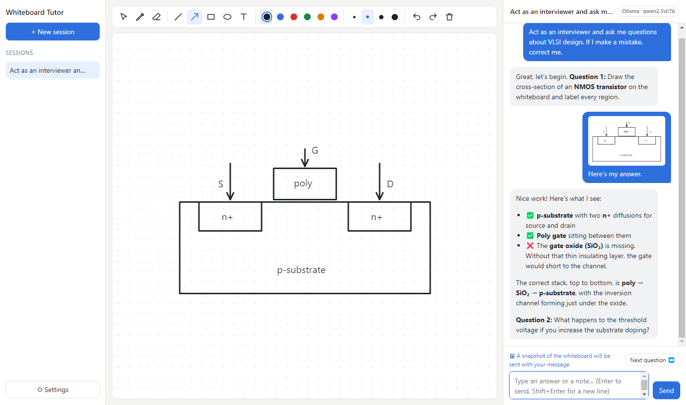

# Whiteboard Tutor

A desktop app with a whiteboard and an AI chat side by side. Each time you send a message, the app attaches a snapshot of the whiteboard, so the AI can check what you drew: diagrams, circuits, cross-sections, derivations.

It works with **Ollama** (local, free, private), your **Claude Pro / Max subscription** (through Claude Code), or a **Claude API key**.

## Example



*You draw an NMOS cross-section without the gate oxide, and the tutor spots the mistake and moves on to the next question.*

> **You:** Act as an interviewer and ask me questions about VLSI design. If I make a mistake, correct me.
>
> **AI:** Great! Let's start simple. Draw the cross-section of an NMOS transistor on the whiteboard and label all the regions.
>
> *(you draw it, optionally type "here's my answer", and press Send)*
>
> **AI:** Here's what I see… you're missing the gate oxide between the poly gate and the substrate. The correct stack is… Next question: …

## Setup

You need **Node.js 18+**.

```bash
npm install
npm start
```

The Settings dialog opens on first launch.

### Option A: Ollama (local)
1. Install Ollama from https://ollama.com.
2. Pull a model that **can read images**:
   ```bash
   ollama pull qwen2.5vl      # good at diagrams and text in images
   # or: gemma3, llama3.2-vision, llava
   ```
3. In Settings, choose **Ollama**, press **Refresh**, and pick the model.

Text-only models (for example `llama3`) will chat but can't see the whiteboard.

### Option B: Claude Pro / Max subscription
The app talks to Claude through **Claude Code**, Anthropic's command-line tool, which you can log in to with your subscription. No API key is needed.

1. Install Claude Code by following https://claude.com/claude-code.
2. Open a terminal, run `claude`, and log in with your Claude Pro account (type `/login` if it doesn't ask). Then exit Claude Code.
3. In the app's Settings, choose **Claude Pro / Max subscription** and click **Check**. It should say "Found … (Claude Code)".
4. Pick a model. **Plan default** is fine; **Opus** reads diagrams best but uses up your limit faster.

Messages count toward the same usage limits as claude.ai. Claude Code runs with all its tools turned off, so it can only chat. It can't read your files or run commands. If `ANTHROPIC_API_KEY` is set on your computer, the app hides it from Claude Code so you're never billed through the API by accident.

### Option C: Claude API key
1. Get an API key at https://console.anthropic.com.
2. In Settings, choose **Claude** and paste the key. It is stored encrypted using your OS keychain. Alternatively, set `ANTHROPIC_API_KEY` in your environment.
3. Pick a model. **Opus 5.5** gives the best diagram checking; **Sonnet 5.5** and **Haiku 5.5** are faster and cheaper.

## Using the whiteboard

| Tool | Key | Notes |
|---|---|---|
| Select / move | V | Drag to move. Delete removes the selection. Double-click a label to edit it. |
| Pen | P | |
| Eraser | E | Removes whole strokes or shapes |
| Line / Arrow | L / A | Hold Shift to snap to 45° |
| Rectangle / Ellipse | R / O | Hold Shift for a square or circle |
| Text label | T | Click to place. Enter to finish, Shift+Enter for a new line. |
| Undo / Redo | Ctrl+Z / Ctrl+Y | |

The app crops the snapshot to what you drew, so empty space doesn't matter. If the board is empty, only your text is sent.

When you're done with a question, click **Next question** (above the chat box). It clears the board and asks the AI to move on. Anything you've half-typed stays in the box, and Ctrl+Z brings the cleared drawing back.

## Sessions

Every chat and its whiteboard are saved automatically. Pick an earlier session from the left sidebar to review it or carry on. Click a snapshot in the chat to see exactly what the AI was shown.

Data location:
- Windows: `%APPDATA%\whiteboard-tutor`
- macOS: `~/Library/Application Support/whiteboard-tutor`
- Linux: `~/.config/whiteboard-tutor`

## Running the tests

The end-to-end tests launch the real app and drive it against mock Ollama and Claude servers, so you don't need a model or an API key to run them:

```bash
npm test                 # Windows / macOS
xvfb-run -a npm test     # Linux without a display
```

They use a temporary data folder, so your real sessions and settings are never touched.

## Building an installer

```bash
npm run dist
```

This produces an installer for your current OS in `dist/` (via electron-builder).

## Project layout

```
main.js            Electron main process: AI calls (Claude SDK / Ollama), settings, session files
preload.js         Safe bridge between the UI and main process
src/index.html     Layout
src/styles.css     Styling
src/whiteboard.js  Vector whiteboard (tools, undo, PNG export)
src/app.js         Chat, sessions, settings UI
test/e2e.test.js   End-to-end tests (Playwright + mock AI servers)
```

To change how the AI behaves, edit `SYSTEM_PROMPT` at the top of `main.js`. For example, you can make it stricter, or ask it to give hints before full answers.
